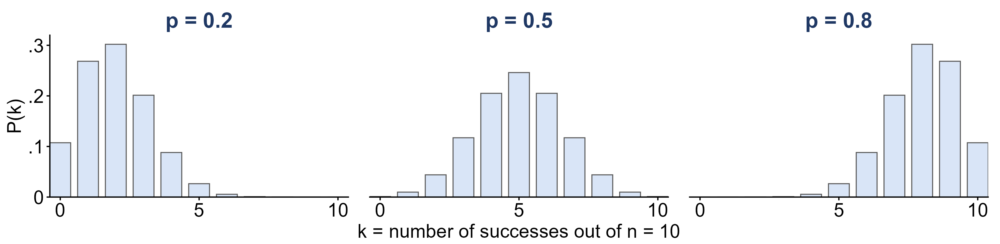
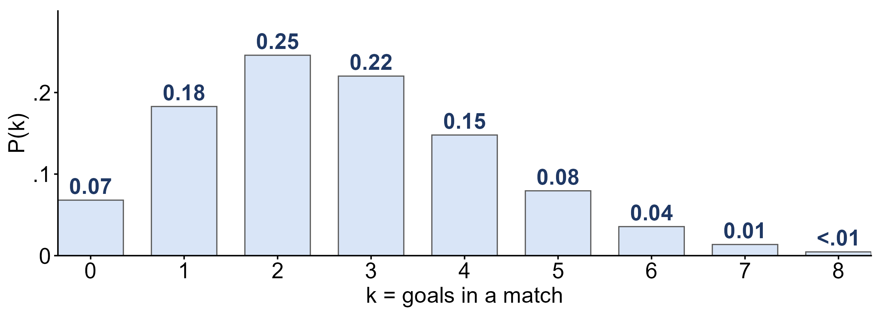

```{r setup, include=FALSE}
knitr::opts_chunk$set(echo = TRUE)
library(knitr)
library(kableExtra)
library(ggplot2)
library(ggthemes)
library(ggpubr)
library(latex2exp)

path = 'Data/'

fmt <- function(x, d = 2) formatC(x, format = 'f', digits = d)
tab <- function(df, ...) kable(df, format = 'html', row.names = FALSE, escape = FALSE, ...) %>%
  kable_classic(full_width = FALSE, html_font = "Cambria") %>%
  kable_styling(bootstrap_options = 'striped')

# the hand formulas, exactly as written below
binom_pmf <- function(k, n, p) factorial(n) / (factorial(k) * factorial(n - k)) * p^k * (1 - p)^(n - k)
pois_pmf  <- function(k, lambda) lambda^k * exp(-lambda) / factorial(k)
near <- function(a, b, tol = 5e-4) abs(a - b) < tol

# every number quoted on this page is computed here. The Lecture 15 numbers are the
# same ones asserted in assets/make_lecture15_figures.R.
quiz  <- binom_pmf(0:10, 10, 0.25)
p_ft  <- 4236 / 4645
lam   <- 172 / 64
trout <- 500 / 10000
stopifnot(near(quiz[4], 0.250), near(quiz[1], 0.056), near(sum(quiz[7:11]), 0.020),
          near(p_ft, 0.912), near(0.912^10, 0.398), near(binom_pmf(9, 10, 0.912), 0.384),
          near(lam, 2.69, 5e-3), near(pois_pmf(0, lam), 0.068), near(exp(-lam / 2), 0.26, 5e-3),
          trout == 0.05, near(1 - 0.95^10, 0.401),
          near(binom_pmf(5, 100, 0.05), 0.180), near(pois_pmf(5, 5), 0.175))
```

<!--
  SCOPE OF THIS PAGE (Fall 2026 rewrite, Oct 5 2026).

  Week 7 is three lectures (see Course_Schedule.Rmd, the date source of truth):
    Mon Oct 5    Lecture 15  opens with the end of the Week 6 probability section
                             (independence through expected value, carried from
                             Lecture 14 and written up on the Week 6 page), then the
                             Bernoulli, binomial and Poisson distributions
                             lecture_slides/Week 7/2026/Week7_Lecture15_Slides_10_5_2026.pptx
    Wed Oct 7    Lecture 16  expected value and the Bernoulli and binomial distributions
                             (carried from Lecture 15, which stopped at its slide 15)
                             lecture_slides/Week 7/2026/Week7_Lecture16_Slides_10_7_2026.pptx
    Fri Oct 9    Lecture 17  two more binomial examples (Curry free throws, a lymphoma
                             cluster), the Poisson distribution, and continuous
                             distributions through the normal only (Lecture 16 stopped
                             at its slide 11). The uniform, step, triangle and quartile
                             examples below are reading, not slide material.
                             lecture_slides/Week 7/2026/Week7_Lecture17_Slides_10_9_2026.pptx
    Mon Oct 12   Lecture 18  (Week 8) sampling distributions, the central limit theorem
                             and the introduction to confidence intervals: written up on
                             the Week 8 page, not here.
  The sections below follow that order. The Lecture 15 examples (guessing on a quiz,
  Stephen Curry's free throws, goals at the 2022 World Cup) are the slide examples;
  their numbers and sources are in assets/make_lecture15_figures.R.

  Sources. Terms follow OpenStax Introductory Statistics 2e, Sections 4.3, 4.6 and
  5.1. This page rewrites the 2024 Week 7 page and
  pulls in 2024 lecture material:
    * kept from the 2024 page: recoding a category as a Bernoulli trial, the
      binomial coefficient and factorials, the Poisson conditions and examples of
      Poisson counts, counting boxes under a step density, the triangle density,
      and the Coho salmon derivation (now on the Week 8 page);
    * from the 2024 decks: the tiger trout (2024 Lecture 13 slide 8, Lecture 15
      slide 19), the density-quartiles example (2024 Lecture 13 slide 16), the
      rectangles that approximate an area (2024 Lecture 13 slides 13-15), "height
      is density, not probability" and the cumulative-probability rules (2024
      Lecture 15 slides 3-6);
    * the sampling-distribution and central limit theorem section drafted here on
      Oct 5 (Coho salmon, three distributions, the CLT) MOVED to the Week 8 page on
      Oct 12 2026, since it was taught Mon Oct 12 in Lecture 18.
  Dropped: the Luis Arraez and call-center examples (replaced by the slide examples),
  the Star Wars Poisson example, and the 2024 Texas hold'em table, whose probabilities
  were wrong (P(no ace in two cards) = C(48,2)/C(52,2) = 0.851, not 0.559).
  The 2024 "four-sided die, n = 2" derivation is NOT used: it is Homework 3 problem 1.
  Homework 2 problem 10 asks students to confirm mu = p and sigma^2 = p(1-p) for a
  Bernoulli, so this page states those results without deriving them.
-->

# Named discrete distributions

Monday opens with the end of the probability section from the [Week 6 notes](lecturemenu6.html):
the general addition rule and independence, the examples on the heights table, sampling with
and without replacement, random variables, discrete probability distributions and expected
value. Those are written up there, starting at
[Combining two events](lecturemenu6.html#combining-two-events).

Last week every probability distribution was built by hand: list the outcomes, count, add. Some
random processes come up so often that their distributions have names and formulas. Each one is a
**probability model**: a description of a chance process that, once we know a parameter or two,
tells us the probability of every possible value. This week we meet three discrete models.

## The Bernoulli distribution

* A **Bernoulli trial** is a single random trial with exactly two possible outcomes, called
  "success" and "failure". The random variable $X$ records a success as $X = 1$ and a failure as
  $X = 0$.
* Its distribution has one parameter, the **probability of success** $p$:

```{r, echo=FALSE}
tab(data.frame(x = c('0 (failure)', '1 (success)'), p = c('$1 - p$', '$p$')),
    col.names = c('$x$', '$P(x)$'))
```

We write $X \sim \text{Bernoulli}(p)$. Its mean and variance are
$$\mu = p \qquad\qquad \sigma^2 = p(1 - p)$$
(Homework 2 asks you to check these with the formulas $\mu = \sum x\, P(x)$ and
$\sigma^2 = \sum (x - \mu)^2 P(x)$ from Week 6.) The name honors Jacob Bernoulli, the same Swiss
mathematician who proved the law of large numbers.

"Success" does not have to be good news; it is just the outcome we are counting. A coin landing
heads, a patient recovering, a part being defective and a voter supporting a candidate can all be
successes.

**Any categorical variable can be turned into a Bernoulli trial.** Suppose $Z$ records whether a
randomly chosen person's pet is a cat, a dog or a fish, with probabilities $p_1$, $p_2$ and $p_3$.
If what we care about is whether the person has a dog, call "dog" a success and everything else a
failure. Then $Y = 1$ for a dog owner, with probability $p_2$, and $Y = 0$ otherwise, with
probability $p_1 + p_3 = 1 - p_2$, so $Y \sim \text{Bernoulli}(p_2)$.

### Example: guessing one question

You guess on a multiple-choice question with 4 options, one of them correct. Let $X = 1$ if the guess
is right. Then $X \sim \text{Bernoulli}(0.25)$:

* $P(X = 0) = 1 - 0.25 = 0.75$;
* $\mu = 0.25$ and $\sigma^2 = 0.25 \times 0.75 = 0.1875$.

The mean of a 0/1 variable is the proportion of 1s, so $\mu = 0.25$ says that in the long run a
quarter of your guesses are right.

## The binomial distribution

One Bernoulli trial is not very interesting. Repeat it, and count the successes. The textbook lists
three characteristics of this **binomial setting**:

1. **A fixed number of trials** $n$, decided in advance.
2. **Two outcomes on every trial**, success or failure, with **the same probability of success** $p$
   each time (and probability of failure $q = 1 - p$).
3. **Independent trials**: the outcome of one trial does not change the probability of success on any
   other.

* A **binomial random variable** $X$ is the number of successes in such a setting. Its distribution,
  the **binomial distribution**, has two parameters, $n$ and $p$, and we write $X \sim \text{Binom}(n, p)$.
  (The textbook writes $X \sim B(n, p)$.) A Bernoulli random variable is the special case $n = 1$.

The probability of exactly $k$ successes is
$$P(X = k) = \frac{n!}{k!\,(n - k)!}\; p^k\, (1 - p)^{n - k}, \qquad k = 0, 1, \ldots, n$$
and the mean and variance are
$$\mu = np \qquad\qquad \sigma^2 = np(1 - p) \qquad\qquad \sigma = \sqrt{np(1 - p)}$$

The mean makes sense: in $n$ trials that each succeed with probability $p$, you expect $np$
successes.

**Where the formula comes from.** The symbol $!$ is a **factorial**: the product of all the positive
whole numbers up to that number,
$$n! = n \times (n - 1) \times (n - 2) \times \cdots \times 1, \qquad\text{so } 5! = 5 \times 4 \times 3 \times 2 \times 1 = 120$$
and, by definition, $0! = 1$. The first factor in the formula, the **binomial coefficient**
$$\binom{n}{k} = \frac{n!}{k!\,(n - k)!}$$
counts the number of different orders in which $k$ successes can fall among $n$ trials. Each one of
those orders has probability $p^k (1 - p)^{n - k}$ by the multiplication rule, because the trials
are independent. Multiplying the two gives $P(X = k)$.

### Example: three tosses again

In Week 6 we found the distribution of $X$ = the number of heads in 3 tosses of a fair coin by listing
all 8 outcomes. That is the binomial setting with $n = 3$ and $p = 0.5$, so the formula should give
the same answer:
$$P(X = 2) = \frac{3!}{2!\,1!}\,(0.5)^2\,(0.5)^1 = 3 \times \frac{1}{8} = \frac{3}{8}$$
The coefficient $3!/(2!\,1!) = 3$ counts the three orders with 2 heads, HHT, HTH and THH, exactly the
outcomes we counted by hand. The formula just saves us from listing them when $n$ is large.

### Example: guessing a whole quiz

You guess on all 10 questions of a 4-option multiple-choice quiz, so the number right is
$X \sim \text{Binom}(10, 0.25)$.

* $P(X = 3) = \dfrac{10!}{3!\,7!}(0.25)^3(0.75)^7 = 120 \times 0.0156 \times 0.1335 \approx `r fmt(quiz[4], 3)`$
* $P(X = 0) = (0.75)^{10} \approx `r fmt(quiz[1], 3)`$: about 1 time in 18 you get every question wrong.
* $\mu = 10 \times 0.25 = 2.5$ questions and $\sigma = \sqrt{10 \times 0.25 \times 0.75} \approx `r fmt(sqrt(1.875), 2)`$.

The whole distribution:

```{r, echo=FALSE}
qd <- data.frame(k = 0:10, p = fmt(quiz, 3))
tab(as.data.frame(t(qd$p)), col.names = paste0('$', 0:10, '$')) %>%
  add_header_above(c('$P(X = k)$ for $k =$' = 11), escape = FALSE)
```

To pass with 6 or more right you need $P(X \geq 6) = P(6) + P(7) + \cdots + P(10) \approx
`r fmt(sum(quiz[7:11]), 3)`$, about a 2% chance. Guessing is not a strategy.

### Example: tiger trout

A tiger trout is a sterile cross between a brown trout and a brook trout, raised in hatcheries and
stocked into lakes and ponds. Suppose 500 of the 10,000 trout stocked in a reservoir are tiger trout
and the fish are well mixed, so each fish caught is a tiger trout with probability
$p = 500/10{,}000 = 0.05$. (With 10,000 fish, catching a few barely changes the mix, so the catches
behave like independent trials; see "Sampling with and without replacement" in the Week 6 notes.)

* The probability that the first fish you catch is a tiger trout is just $p = 0.05$.
* The probability of at least one tiger trout among your first 10 fish is easiest through the
  complement:
  $$P(X \geq 1) = 1 - P(X = 0) = 1 - (0.95)^{10} \approx `r fmt(1 - 0.95^10, 3)`$$

### Example: free throws

Stephen Curry has made 4,236 of the 4,645 free throws he has attempted in the NBA, so take
$p = 4236/4645 \approx 0.912$. If he shoots 10 free throws and the shots are independent,
$X \sim \text{Binom}(10, 0.912)$:

* $P(\text{all } 10) = (0.912)^{10} \approx `r fmt(0.912^10, 2)`$, so even one of the best free-throw
  shooters ever misses at least one of 10 about 60% of the time;
* $P(X = 9) = 10\,(0.912)^9(0.088) \approx `r fmt(binom_pmf(9, 10, 0.912), 2)`$;
* on average he makes $\mu = np = 10 \times 0.912 \approx 9.1$.

"At least" questions are easiest through the complement. The probability he makes **at least 2** of
the 10 is one minus the probability he makes fewer than 2:
$$P(X \geq 2) = 1 - P(X < 2) = 1 - [P(0) + P(1)] = 1 - [0.088^{10} + 10(0.912)(0.088)^9] \approx 1 - 0.000000003$$
which is 1 to eight decimal places.

### Example: a lymphoma cluster?

A doctor in a rural California county finds that 71 of his 893 patients, about 8%, were diagnosed
with lymphoma in the last year. In the US the rate of new lymphoma cases is about 21 per 100,000 people
a year (SEER, 2018--2022: 18.7 for non-Hodgkin and 2.5 for Hodgkin lymphoma), so take $p = 0.00021$.
Before reporting to the CDC, the doctor asks how likely so many cases would be if his patients had
only the national rate: $X \sim \text{Binom}(893, 0.00021)$.

* At the national rate he should expect $\mu = 893 \times 0.00021 \approx `r fmt(893 * 0.00021, 2)`$
  cases, less than one.
* $P(X \geq 71) = 1 - P(X \leq 70)$, which is 71 terms of the formula. Software does it:
  `pbinom(70, size = 893, prob = 0.00021, lower.tail = FALSE)` returns about
  $`r sub('e-', ' \\\\times 10^{-', formatC(pbinom(70, 893, 0.00021, lower.tail = FALSE), format = 'e', digits = 0))`}$.
  (Typing `1 - pbinom(70, 893, 0.00021)` returns exactly 0: the true answer is too small for the
  computer to tell apart from 1 - 1.)

A count this large is essentially impossible by chance at the national rate, so the doctor should
report it. That is the logic of a hypothesis test, which is coming after Exam 2.

## The shape of a binomial distribution

```{r, echo=FALSE, out.width='100%', fig.align='center', fig.alt = "Three bar charts of Binom(10, p), P(k) against k = 0 to 10. With p = 0.2 the bars peak at k = 2 and trail off to the right (skewed right); with p = 0.5 they are symmetric about k = 5; with p = 0.8 they peak at k = 8 and trail off to the left (skewed left)."}

```

Each panel is $\text{Binom}(10, p)$. With $p = 0.5$ the distribution is **symmetric**. When $p$ is
small, the counts pile up near 0 and the distribution is **skewed right**; when $p$ is large it is
**skewed left**. In each case the peak sits near the mean $np$: 2, 5 and 8. As $n$ grows, the
distribution becomes more and more bell shaped even when $p$ is not 0.5, which is the central limit
theorem at the end of this page.

## Is it binomial?

Check the three conditions before reaching for the formula.

* **The number of heads in 20 flips of a coin.** Yes: $n = 20$ is fixed, $p = 0.5$ on every flip, and
  the flips are independent.
* **The number of aces in a 5-card hand.** No: the cards are dealt without replacement, so the draws
  are not independent. After an ace, only 3 of the 51 remaining cards are aces.
* **The number of rolls of a die until the first six.** No: the number of trials is not fixed in
  advance; it *is* the random variable. (This is the geometric distribution, textbook Section 4.4.)

## The Poisson distribution

The binomial counts successes out of a fixed number of trials. Some counts have no "number of
trials" at all: the number of goals in a soccer match, of emails in an hour, of defects in a sheet
of glass. The **Poisson distribution**, named after the French mathematician Siméon Denis Poisson
(1781–1840), models counts like these. A Poisson random variable counts events in a **fixed interval**
of time or space when

* events occur **independently**: one event does not make another more or less likely;
* events occur at a **constant average rate**, the same in every part of the interval;
* two events cannot happen at exactly the same instant.

The distribution has one parameter, the **rate** $\lambda$ (lambda), the average number of events in
the interval. We write $X \sim \text{Poisson}(\lambda)$, and

$$P(X = k) = \frac{\lambda^k\, e^{-\lambda}}{k!}, \qquad k = 0, 1, 2, \ldots$$

$$\mu = \lambda \qquad\qquad \sigma^2 = \lambda \qquad\qquad \sigma = \sqrt{\lambda}$$

There is no upper limit on $k$. The number $e \approx 2.718$ is **Euler's number**, a constant that
turns up throughout mathematics; every scientific calculator has an $e^x$ button. (The textbook writes
the parameter as $\mu$ and the distribution as $X \sim P(\mu)$.)

Other counts that are often modeled as Poisson: mutations on a strand of DNA, defective products per
hour on an assembly line, bankruptcies filed in a month, and internet outages in a month.

### Example: World Cup goals

The 2022 FIFA World Cup produced 172 goals in its 64 matches, so take
$\lambda = 172/64 \approx 2.69$ goals per match and let $X$ = the number of goals in one match.

* $P(X = 0) = e^{-2.69} \approx `r fmt(pois_pmf(0, lam), 3)`$.
* So out of 64 matches the model expects $64 \times `r fmt(pois_pmf(0, lam), 3)` \approx
  `r fmt(64 * pois_pmf(0, lam), 1)`$ to end 0–0. There were actually 7. Close, but a model is never a
  perfect fit: real matches break the "constant rate" condition, since a team that falls behind
  attacks harder.
* **Change the interval, change $\lambda$.** A 45-minute half is half a match, so the rate for one
  half is $\lambda = 2.69/2 \approx 1.34$, and
  $P(\text{no goals in a half}) = e^{-1.34} \approx `r fmt(exp(-lam / 2), 2)`$.

The standard deviation is $\sigma = \sqrt{2.69} \approx `r fmt(sqrt(lam), 2)`$ goals. Here is the whole
distribution:

```{r, echo=FALSE, out.width='80%', fig.align='center', fig.alt = "Bar chart of the Poisson(2.69) distribution of goals in a match, k = 0 to 8, with probabilities 0.07, 0.18, 0.25, 0.22, 0.15, 0.08, 0.04, 0.01 and less than 0.01. The peak is at 2 goals and there is a long right tail."}

```

Two goals is the most likely score total, then three. The distribution is **skewed right**: $X$ cannot
go below 0, but there is no upper limit.

### The Poisson as an approximation to the binomial

When $n$ is large and $p$ is small, a binomial count behaves like a Poisson count with
$\lambda = np$. Back to the tiger trout: in a day's catch of 100 fish with $p = 0.05$, the number of
tiger trout is $\text{Binom}(100, 0.05)$, and

$$\text{binomial: } P(X = 5) = \frac{100!}{5!\,95!}(0.05)^5(0.95)^{95} \approx `r fmt(binom_pmf(5, 100, 0.05), 3)` \qquad
\text{Poisson with } \lambda = 5\text{: } P(X = 5) = \frac{5^5 e^{-5}}{5!} \approx `r fmt(pois_pmf(5, 5), 3)`$$

The Poisson is far easier to compute. The textbook's rule of thumb is that the approximation is good
when $n$ is greater than 20 and $p$ is less than 0.05; at $p = 0.05$ we are right at the edge, and the
two answers still agree to two decimal places.

# Continuous probability distributions

```{r continuous-setup, include=FALSE}
# the step density (Lecture 16, kept from the 2024 page): heights in units of one box
box_w <- 0.25; box_h <- 0.16
step_boxes <- c(2, 3, 7, 5, 4, 2, 1, 1)               # on (-1,-0.75), ..., (0.75, 1)
stopifnot(sum(step_boxes) * box_w * box_h == 1, sum(step_boxes[1:4]) == 17)

# the density for quartiles (2024 Lecture 13 slide 16)
q_edges <- c(0, 1, 2, 3, 5, 11); q_dens <- c(0.10, 0.15, 0.25, 0.10, 0.05)
q_area  <- diff(q_edges) * q_dens
stopifnot(abs(sum(q_area) - 1) < 1e-12, all.equal(cumsum(q_area), c(0.10, 0.25, 0.50, 0.70, 1.00)))

# rectangles under the normal model for women's heights (Week 6: mean 65.4, sd 3.38)
HM <- 65.4; HS <- 3.38; lo <- 62; hi <- 70
exact <- pnorm(hi, HM, HS) - pnorm(lo, HM, HS)
rect_area <- function(w) { mids <- seq(lo + w / 2, hi - w / 2, by = w); sum(w * dnorm(mids, HM, HS)) }
areas <- sapply(c(2, 1, 0.25), rect_area)
stopifnot(near(exact, 0.758, 5e-3), all(abs(areas - exact) < c(0.02, 0.005, 0.001)))
```

## From histograms to density curves

So far a random variable's values could be listed: 0, 1, 2, and so on. A **continuous** random
variable, like a height, a time or a temperature, can take any value in an interval, so there are
too many values to list and we cannot give each one a probability.

We have already seen the fix. In Week 6 a histogram of 150 years of Central Park January
temperatures was smoothed into a **density curve**, and the proportion of Januaries in any range was
the **area** under the curve over that range. A continuous probability distribution works the same
way, with "proportion of the data" replaced by "probability".

* The **probability density function** (pdf) of a continuous random variable $X$ is a curve $f(x)$
  with three properties:
  1. $f(x) \geq 0$ everywhere: the curve never dips below the $x$-axis;
  2. the total area under the curve is 1;
  3. **probability is area**: $P(a < X < b)$ is the area under the curve between $a$ and $b$.

This is what the textbook means by "PROBABILITY = AREA". Three consequences that trip people up:

* **The height of the curve is not a probability.** The $y$-axis measures *probability density*, and a
  density can be bigger than 1. Only areas are probabilities.
* **Any single value has probability 0**: $P(X = c) = 0$, because the "area" over a single point is a
  line with no width. A height of *exactly* 70.000... inches has probability 0, even though heights
  near 70 are common.
* So for a continuous variable **$<$ and $\leq$ give the same answer**: $P(X < c) = P(X \leq c)$.

Finding an area under a general curve takes calculus, which this course does not use. Instead we use
simple shapes whose areas we can compute with geometry, and tables or software for the normal curve.

### Example: a uniform distribution

A campus shuttle arrives every 20 minutes and you show up at a random time, so your wait $X$ is equally
likely to be anywhere between 0 and 20 minutes. Its density is flat:
$$f(x) = \frac{1}{20} \quad\text{for } 0 \leq x \leq 20$$
a rectangle with area $20 \times \frac{1}{20} = 1$. This is the **uniform distribution**. Every
probability is the area of a smaller rectangle, base times height:

* $P(X < 5) = 5 \times \frac{1}{20} = 0.25$;
* $P(4 < X < 15) = (15 - 4) \times \frac{1}{20} = 0.55$;
* $P(X = 15) = 0 \times \frac{1}{20} = 0$;
* $P(X > 15) = (20 - 15) \times \frac{1}{20} = 0.25$.

```{r, echo=FALSE, fig.height=3, fig.width=8, fig.align='center', fig.alt = "Uniform density for wait time: a flat line at height 1/20 from 0 to 20 minutes, with the rectangle from 4 to 15 minutes shaded and labelled P(4 < X < 15) = 0.55."}
ggplot() +
  annotate('rect', xmin = 4, xmax = 15, ymin = 0, ymax = 1/20, fill = 'lightblue', alpha = 0.8) +
  annotate('segment', x = c(0, 0, 20), xend = c(20, 0, 20), y = c(1/20, 0, 0), yend = c(1/20, 1/20, 1/20),
           linewidth = 1) +
  annotate('text', x = 9.5, y = 0.025, label = 'P(4 < X < 15) = 0.55', size = 5) +
  scale_x_continuous(breaks = c(0, 4, 5, 10, 15, 20)) +
  scale_y_continuous(breaks = c(0, 1/20), labels = c('0', '1/20'), limits = c(0, 0.065)) +
  labs(x = 'Wait (minutes)', y = 'Density') +
  theme_classic2() +
  theme(axis.text = element_text(size = 12), axis.title = element_text(size = 14))
```

### Example: counting boxes

The density of $X$ below is a step function on a grid. Each box is $0.25$ wide and $0.16$ tall, so
each box has area $0.25 \times 0.16 = 0.04$.

```{r, echo=FALSE, fig.height=4.5, fig.width=9, fig.align='center', fig.alt = "Step-function density on a grid of dashed lines, X from -1 to 1 in steps of 0.25, density in steps of 0.16. Bar heights, in boxes, are 2, 3, 7, 5, 4, 2, 1 and 1 from left to right; the four bars left of 0 are shaded."}
sx <- seq(-1, 0.75, by = box_w)
sd_df <- data.frame(xmin = sx, xmax = sx + box_w, h = step_boxes * box_h)
ggplot(sd_df) +
  geom_rect(aes(xmin = xmin, xmax = xmax, ymin = 0, ymax = h),
            fill = ifelse(sd_df$xmax <= 0, 'lightblue', 'white'), color = 'black', linewidth = 0.8) +
  geom_hline(yintercept = seq(0, 7 * box_h, box_h), color = 'grey70', linetype = 'dashed', linewidth = 0.3) +
  geom_vline(xintercept = seq(-1, 1, box_w), color = 'grey70', linetype = 'dashed', linewidth = 0.3) +
  scale_x_continuous(breaks = seq(-1, 1, 0.25)) +
  scale_y_continuous(breaks = seq(0, 7 * box_h, box_h)) +
  labs(x = 'X', y = 'Probability density') +
  theme_classic2() +
  theme(axis.text = element_text(size = 12), axis.title = element_text(size = 14))
```

There are `r sum(step_boxes)` boxes under the curve in all, and $`r sum(step_boxes)` \times 0.04 = 1$,
so this is a valid density. The shaded region, to the left of 0, holds
$`r paste(step_boxes[1:4], collapse = ' + ')` = `r sum(step_boxes[1:4])`$ boxes, so
$$P(X < 0) = `r sum(step_boxes[1:4])` \times 0.04 = `r fmt(sum(step_boxes[1:4]) * 0.04, 2)`$$

### Example: a triangle

The density of $W$ below rises in a straight line from 0 at $W = 0$ to a peak of 0.4 at $W = 2$, then
falls back to 0 at $W = 5$. The whole triangle has area $\frac{1}{2} \times 5 \times 0.4 = 1$.

```{r, echo=FALSE, fig.height=4, fig.width=9, fig.align='center', fig.alt = "Triangular density for W: a line rising from 0 at W = 0 to a peak of 0.4 at W = 2, then falling to 0 at W = 5. The small triangle from W = 0 to 1, reaching height 0.2, is shaded."}
tri <- data.frame(x = c(0, 2, 5), y = c(0, 0.4, 0))
ggplot(tri, aes(x, y)) +
  geom_polygon(data = data.frame(x = c(0, 1, 1), y = c(0, 0.2, 0)), fill = 'lightblue') +
  geom_line(linewidth = 1) +
  scale_x_continuous(breaks = 0:5) +
  scale_y_continuous(breaks = seq(0, 0.4, 0.1), limits = c(0, 0.45)) +
  labs(x = 'W', y = 'Probability density') +
  theme_classic2() +
  theme(axis.text = element_text(size = 12), axis.title = element_text(size = 14))
```

* $P(W \leq 1)$ is the small shaded triangle. The density climbs $0.4$ over 2 units, $0.2$ per unit,
  so at $W = 1$ its height is $0.2$:
  $$P(W \leq 1) = \tfrac{1}{2} \times 1 \times 0.2 = 0.1$$
* $P(W > 2)$ is the right-hand triangle, base 3 and height 0.4:
  $P(W > 2) = \frac{1}{2} \times 3 \times 0.4 = 0.6$. So $P(W \leq 2) = 1 - 0.6 = 0.4$.

### Approximating an area with rectangles

When the curve is not made of straight lines, we can still approximate the area under it with
rectangles, just as a histogram does. Take the normal model for the women's heights from Week 6,
$X \sim N(65.4, 3.38)$, and the probability that a woman is between 62 and 70 inches tall:

```{r, echo=FALSE, fig.height=3.6, fig.width=11, fig.align='center', fig.alt = "Three panels, each the normal curve for women's heights with mean 65.4 and sd 3.38, with rectangles under the curve between 62 and 70 inches. The rectangles are 2, 1 and 0.25 inches wide from left to right, each panel titled with the total rectangle area; the thinner rectangles follow the curve more closely."}
rect_plot <- function(w) {
  mids <- seq(lo + w / 2, hi - w / 2, by = w)
  r <- data.frame(xmin = mids - w / 2, xmax = mids + w / 2, h = dnorm(mids, HM, HS))
  ggplot() +
    geom_rect(data = r, aes(xmin = xmin, xmax = xmax, ymin = 0, ymax = h),
              fill = 'lightgrey', color = 'black', linewidth = 0.3) +
    stat_function(fun = dnorm, args = list(mean = HM, sd = HS), xlim = c(55, 76), linewidth = 0.8) +
    labs(x = 'Height (inches)', y = 'Density',
         title = paste0('width ', w, ':  area ', fmt(rect_area(w), 4))) +
    theme_classic2() +
    theme(axis.text = element_text(size = 11), axis.title = element_text(size = 12),
          plot.title = element_text(size = 13))
}
ggarrange(rect_plot(2), rect_plot(1), rect_plot(0.25), nrow = 1)
```

The rectangles give `r fmt(areas[1], 4)`, then `r fmt(areas[2], 4)`, then `r fmt(areas[3], 4)`; the
exact area is $P(62 < X < 70) = `r fmt(exact, 4)`$. The thinner the rectangles, the closer the
approximation. Calculus is what you get by letting the rectangles become infinitely thin; `pnorm` and
the $z$-table from Week 6 have done that work for us.

## Cumulative probability

* The **cumulative distribution function** (cdf) of $X$ gives the probability that $X$ is at most a
  value $x$, $P(X \leq x)$: the area under the density to the **left** of $x$.

This is the probability version of the cumulative relative frequency from Week 3, and it is exactly
what a $z$-table and `pnorm` give you. Every other probability comes from it with two rules:

* **Area to the right** (complement rule): $P(X > x) = 1 - P(X \leq x)$.
* **Area between**: $P(a < X < b) = P(X \leq b) - P(X \leq a)$.

For the shuttle, $P(X \leq x) = x/20$, so $P(4 < X < 15) = 15/20 - 4/20 = 0.55$, the same answer as
the rectangle.

## Quartiles of a continuous distribution

The quartiles of a continuous random variable are the values that cut the area into quarters:
$$P(X < Q_1) = 0.25 \qquad P(X < Q_2) = 0.50 \qquad P(X < Q_3) = 0.75$$
so $Q_2$ is the median. To find them, add up area from the left until you reach each target.

```{r, echo=FALSE, fig.height=4, fig.width=10, fig.align='center', fig.alt = "Step density for X from 0 to 11 made of five rectangles: 0 to 1 at height 0.10, 1 to 2 at 0.15, 2 to 3 at 0.25, 3 to 5 at 0.10 and 5 to 11 at 0.05, labelled with areas 0.10, 0.15, 0.25, 0.20 and 0.30. Dashed vertical lines mark Q1 at 2, Q2 at 3 and Q3 at 6."}
qd_df <- data.frame(xmin = head(q_edges, -1), xmax = q_edges[-1], h = q_dens)
ggplot(qd_df) +
  geom_rect(aes(xmin = xmin, xmax = xmax, ymin = 0, ymax = h), fill = 'lightblue', color = 'black', linewidth = 0.8) +
  geom_text(aes(x = (xmin + xmax) / 2, y = h + 0.012, label = paste0('area ', fmt(diff(q_edges) * q_dens, 2))),
            size = 4) +
  geom_vline(xintercept = c(2, 3, 6), color = 'red', linetype = 'dashed') +
  annotate('text', x = c(2, 3, 6), y = 0.285, label = c('Q[1]', 'Q[2]', 'Q[3]'), parse = TRUE, color = 'red', size = 5) +
  scale_x_continuous(breaks = 0:11) +
  scale_y_continuous(breaks = seq(0, 0.25, 0.05), limits = c(0, 0.3)) +
  labs(x = 'X', y = 'Probability density') +
  theme_classic2() +
  theme(axis.text = element_text(size = 12), axis.title = element_text(size = 14))
```

The areas of the five rectangles are 0.10, 0.15, 0.25, 0.20 and 0.30, and they add to 1.

* After the first two rectangles the area is $0.10 + 0.15 = 0.25$, so $Q_1 = 2$.
* The third rectangle adds 0.25, reaching $0.50$ at $x = 3$, so the median is $Q_2 = 3$.
* At $x = 5$ the area is $0.70$. We need $0.05$ more, and the last rectangle has height 0.05, so it
  takes 1 more unit: $Q_3 = 6$.

The long right tail pulls $Q_3$ much further from the median than $Q_1$ is: this distribution is
skewed right.

## Mean and standard deviation of a continuous random variable

The mean $\mu$ and standard deviation $\sigma$ of a continuous random variable mean exactly what they
meant for a discrete one, but computing them generally takes calculus.

* The **mean** $\mu$ is the **balance point** of the density curve: if the curve were cut out of
  cardboard, it would balance on $\mu$. For a symmetric density it is the center (10 minutes for the
  shuttle); for a skewed one it is pulled toward the long tail, past the median.
* The **standard deviation** $\sigma$ measures the spread of the curve around $\mu$.

The normal distribution, $X \sim N(\mu, \sigma)$, is the most important continuous distribution, and
it is the one case where the two parameters *are* the mean and standard deviation. Everything in the
Week 6 notes about finding areas under it, with $z$-scores, the $z$-table and `pnorm`, is the cdf
rules above applied to a bell-shaped curve.

Next week we put these ideas to work on **statistics**. A sample mean or proportion is a random
variable too, and its distribution, the sampling distribution, is the subject of the Week 8 notes.

# Conclusion: what you should take away

## Named discrete distributions

* **Bernoulli($p$):** one trial, success ($X = 1$) with probability $p$; $\mu = p$, $\sigma^2 = p(1 - p)$.
* **Binomial($n$, $p$):** the number of successes in a fixed number $n$ of independent trials with the
  same $p$. $P(X = k) = \frac{n!}{k!(n - k)!}p^k(1 - p)^{n - k}$; $\mu = np$, $\sigma^2 = np(1 - p)$.
  Check all three conditions first: sampling without replacement from a small population, or a
  number of trials that is not fixed, rules it out.
* **Poisson($\lambda$):** the number of events in a fixed interval when events occur independently at a
  constant average rate $\lambda$. $P(X = k) = \frac{\lambda^k e^{-\lambda}}{k!}$; $\mu = \sigma^2 = \lambda$.
  Rescale $\lambda$ when the interval changes.

## Continuous distributions

* A continuous random variable has a **density curve**: never negative, total area 1, and
  **probability = area**. The height is density, not probability, and $P(X = c) = 0$.
* $P(X \leq x)$ is the area to the left (the cdf). $P(X > x) = 1 - P(X \leq x)$ and
  $P(a < X < b) = P(X \leq b) - P(X \leq a)$.
* Quartiles cut the area into quarters; the mean is the balance point.

## Sources

* Illowsky, B. and Dean, S. (2023). *Introductory Statistics 2e*, Sections 4.3, 4.6 and 5.1.
  OpenStax. [OpenStax: Introductory Statistics 2e](https://openstax.org/details/books/introductory-statistics-2e)
* 2022 FIFA World Cup: 172 goals in 64 matches, seven of them 0–0. Wikipedia, "2022 FIFA World Cup",
  tournament statistics; Eurosport, "What is the record number of 0-0 draws at the World Cup".
* Stephen Curry's career free throws, 4,236 of 4,645. Basketball-Reference,
  [Basketball-Reference: Stephen Curry career stats](https://www.basketball-reference.com/players/c/curryst01.html), checked October 5, 2026.
