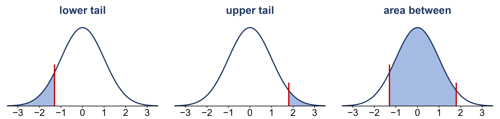
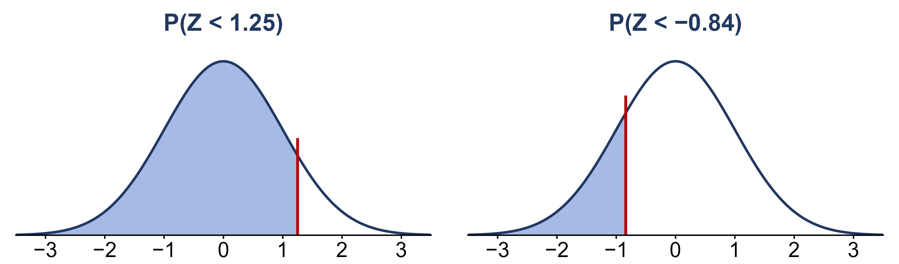
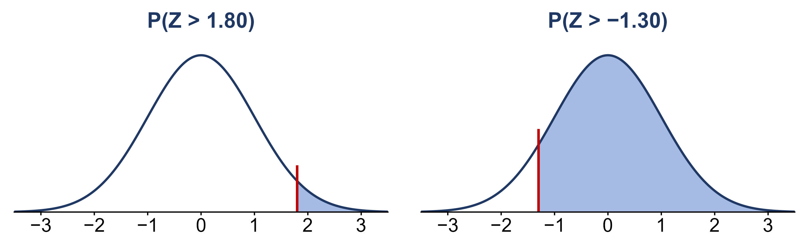
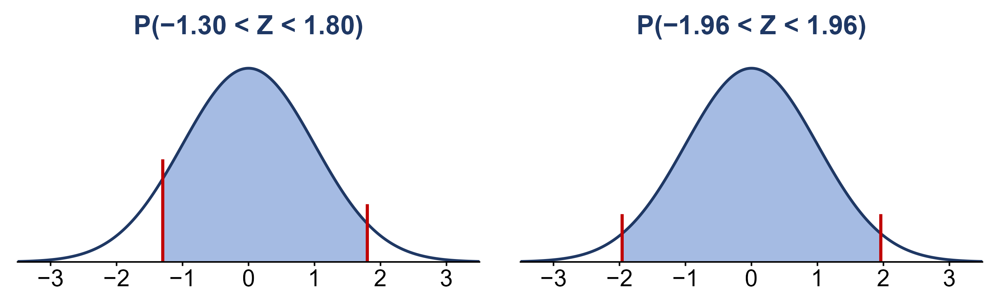

```{r setup, include=FALSE}
knitr::opts_chunk$set(echo = TRUE)
library(knitr)
library(kableExtra)
library(ggplot2)
library(ggthemes)
library(ggpubr)
library(latex2exp)
library(gganimate)

path = 'Data/'

fmt <- function(x, d = 2) formatC(x, format = 'f', digits = d)
tab <- function(df, ...) kable(df, format = 'html', row.names = FALSE, escape = FALSE, ...) %>%
  kable_classic(full_width = FALSE, html_font = "Cambria") %>%
  kable_styling(bootstrap_options = 'striped')
near <- function(a, b, tol = 5e-4) abs(a - b) < tol
zt <- function(z) round(pnorm(z), 4)     # a z-table lookup, four decimals

# every number in the Lecture 19 sections is checked here; the slides' numbers are the
# same ones asserted in assets/make_lecture19_figures.R
stopifnot(zt(1.25) == 0.8944, zt(-0.84) == 0.2005, zt(1.80) == 0.9641, zt(-1.30) == 0.0968,
          zt(1.30) == 0.9032, zt(1.96) == 0.9750, zt(-1.96) == 0.0250,
          zt(2) == 0.9772, zt(0.5) == 0.6915, zt(1) == 0.8413, zt(-1) == 0.1587, zt(-2) == 0.0228,
          zt(1.51) == 0.9345, round((3 - 2.69) / (sqrt(2.69) / 8), 2) == 1.51)

# teens losing focus in class by checking their phones (Pew; the published counts)
teens <- c(Never = 289, Rarely = 216, Sometimes = 178, Often = 60)
x_t <- sum(teens[c('Sometimes', 'Often')]); n_t <- sum(teens)
ph_t <- round(x_t / n_t, 3); se_t <- round(sqrt(ph_t * (1 - ph_t) / n_t), 3)
stopifnot(x_t == 238, n_t == 743, ph_t == 0.320, se_t == 0.017,
          near(ph_t - 2 * se_t, 0.286, 1e-9), near(ph_t + 2 * se_t, 0.354, 1e-9))
```

<!--
  SCOPE OF THIS PAGE (Oct 18 2026). Week 9 per Course_Schedule.Rmd (the date source of truth):
    Mon Oct 19   Lecture 19  finding normal probabilities; the central limit theorem;
                             confidence intervals for a mean and a proportion
                             lecture_slides/Week 9/2026/Week9_Lecture19_Slides_10_19_2026.pptx
    Wed Oct 21   confidence levels other than 95%; the interval for a mean when sigma is unknown
    Fri Oct 23   choosing a minimum sample size, assumptions of estimators
  Lecture 18 (Oct 12) stopped before the central limit theorem, so Lecture 19 picks up the
  Week 8 page from "The central limit theorem" on. The full write-up stays on the Week 8
  page; the CLT section here is a condensed summary that links back to it (numbers match
  the Week 8 page and the Lecture 19 slides). The other sections are new for Lecture 19. Their teaching follows the 2024 notes ("The normal distribution revisited",
  git show 27a60f5:docs/lecturemenu8.Rmd) and the 2024 Lecture 15 slides: shade the area,
  use the table's area-to-the-left, complement for an upper tail, subtract for an area
  between. Figures are the slide figures (assets/make_lecture19_figures.R).

  Everything from "Confidence levels and critical values" down is still the 2024 Week 9
  page (2024 Lecture 18), kept for Wed Oct 21 until it is rewritten.
-->

# Finding normal probabilities

In Week 7 we said that for a continuous random variable, probability is **area under the density
curve**, and that a single value has probability zero, $P(X = c) = 0$. So the questions we ask about a
continuous variable are always about an *interval*: below some value, above it, or between two values.
For the normal distribution those areas come from the **standard normal table** (the $z$-table), which
we first used in Week 6.

The catch is that the table gives only **one** kind of area: the area to the **left** of $z$,
$P(Z \leq z)$, where $Z \sim N(0, 1)$ is the standard normal. Every other area has to be built out of
that one.

```{r, echo=FALSE, out.width='95%', fig.align='center', fig.alt = "Three standard normal curves side by side, each with the z axis from -3 to 3. Left, lower tail: the area to the left of z = -1.30 is shaded. Middle, upper tail: the area to the right of z = 1.80 is shaded. Right, area between: the area between z = -1.30 and z = 1.80 is shaded."}

```

* **Lower tail.** $P(Z < z)$ is the table value itself.
* **Upper tail.** The whole area under the curve is 1, so the area to the right is what is left over:
  $$P(Z > z) = 1 - P(Z \leq z)$$
* **Area between.** Take everything to the left of the larger value, and remove everything to the left
  of the smaller one:
  $$P(a < Z < b) = P(Z \leq b) - P(Z \leq a)$$

Because $P(Z = z) = 0$, it does not matter whether the inequality is $<$ or $\leq$. Always **sketch the
curve and shade the area first**: the picture tells you which rule to use, and whether your answer
should be big or small.

## The lower tail

```{r, echo=FALSE, out.width='80%', fig.align='center', fig.alt = "Two standard normal curves. Left, titled P(Z < 1.25): the area to the left of 1.25 is shaded, most of the curve. Right, titled P(Z < -0.84): the area to the left of -0.84 is shaded, a small part of the left side."}

```

* $P(Z < 1.25)$: row 1.2, column .05 of the table gives **`r fmt(zt(1.25), 4)`**.
* $P(Z < -0.84)$: row $-0.8$, column .04 gives **`r fmt(zt(-0.84), 4)`**. A negative $z$ is below the
  mean, so the area to its left is less than one half.

## The upper tail

```{r, echo=FALSE, out.width='80%', fig.align='center', fig.alt = "Two standard normal curves. Left, titled P(Z > 1.80): only the small area to the right of 1.80 is shaded. Right, titled P(Z > -1.30): the area to the right of -1.30 is shaded, most of the curve."}

```

* $P(Z > 1.80) = 1 - P(Z \leq 1.80) = 1 - `r fmt(zt(1.80), 4)` = `r fmt(1 - zt(1.80), 4)`$.
* $P(Z > -1.30) = 1 - P(Z \leq -1.30) = 1 - `r fmt(zt(-1.30), 4)` = `r fmt(1 - zt(-1.30), 4)`$.

The normal curve is symmetric, so the area to the right of $-1.30$ is the same as the area to the left
of $+1.30$: the table gives $P(Z \leq 1.30) = `r fmt(zt(1.30), 4)`$, the same answer.

## The area between

```{r, echo=FALSE, out.width='80%', fig.align='center', fig.alt = "Two standard normal curves. Left, titled P(-1.30 < Z < 1.80): the area between -1.30 and 1.80 is shaded. Right, titled P(-1.96 < Z < 1.96): the area between -1.96 and 1.96 is shaded, all but the two thin tails."}

```

* $P(-1.30 < Z < 1.80) = `r fmt(zt(1.80), 4)` - `r fmt(zt(-1.30), 4)` = `r fmt(zt(1.80) - zt(-1.30), 4)`$.
* $P(-1.96 < Z < 1.96) = `r fmt(zt(1.96), 4)` - `r fmt(zt(-1.96), 4)` = `r fmt(zt(1.96) - zt(-1.96), 4)`$.

Remember that second one. Exactly 95% of a normal distribution lies within **1.96** standard deviations
of the mean; the empirical rule's "2" is that number rounded. It is where the 2 in a 95% confidence
interval comes from.

## Practice

For $Z \sim N(0, 1)$, sketch and shade each area, then use the table:

(a) $P(Z \leq 2.00)$ &emsp; (b) $P(Z > 0.50)$ &emsp; (c) $P(-1 < Z < 1)$ &emsp; (d) $P(-2 < Z < 2)$

Answers:

* (a) `r fmt(zt(2), 4)`
* (b) $1 - `r fmt(zt(0.5), 4)` = `r fmt(1 - zt(0.5), 4)`$
* (c) $`r fmt(zt(1), 4)` - `r fmt(zt(-1), 4)` = `r fmt(zt(1) - zt(-1), 4)`$, about 68%
* (d) $`r fmt(zt(2), 4)` - `r fmt(zt(-2), 4)` = `r fmt(zt(2) - zt(-2), 4)`$, about 95%

(c) and (d) are the empirical rule from Week 6: about 68% of a normal distribution lies within one
standard deviation of the mean and about 95% within two.

## Any normal distribution

The same three rules work for any normal variable $X \sim N(\mu, \sigma)$: first convert each value to a
$z$-score, $z = (x - \mu)/\sigma$, then find the area for $Z$. For example, if $X \sim N(5, 10)$, then
$P(X \geq 25) = P(Z \geq 2) = 1 - `r fmt(zt(2), 4)` = `r fmt(1 - zt(2), 4)`$. The central limit theorem,
next, uses exactly this, with the standard error in place of $\sigma$.

# The central limit theorem and an interval for a mean

This section is a summary. The full version, with the simulations, pictures and worked examples, is on
the [Week 8 notes page, starting at "The central limit theorem"](lecturemenu8.html#the-central-limit-theorem).

## The theorem

In Week 8 we found the **center** and **spread** of the sampling distribution of $\bar{x}$: mean $\mu$
and standard error $\sigma/\sqrt{n}$. The **central limit theorem** (CLT) gives its **shape**:

* **Central limit theorem.** Take random samples of size $n$ from **any** population with mean $\mu$
  and standard deviation $\sigma$. If $n$ is large enough, the sampling distribution of $\bar{x}$ is
  approximately normal:
  $$\bar{x} \sim N\!\left(\mu,\; \frac{\sigma}{\sqrt{n}}\right)$$
  A sample proportion is a sample mean of 0s and 1s, so the same is true of $\hat{p}$:
  $$\hat{p} \sim N\!\left(p,\; \sqrt{\frac{p(1 - p)}{n}}\right)$$

The surprising part is "**any** population". Even when the population is skewed, like the minutes
until the next goal at the World Cup, averages of enough observations are bell shaped. The larger $n$
is, the better the approximation. The textbook's guides for "large enough" are:

* $n \geq 30$ for $\bar{x}$. A population that is close to normal needs less; one that is very skewed or
  has extreme outliers may need more.
* $np > 5$ and $n(1 - p) > 5$ for $\hat{p}$, so there are enough successes *and* failures.

## Using it

Because $\bar{x}$ is approximately normal, we can find probabilities about it with the $z$-table,
exactly as in the first part of these notes. The one change is that we standardize with the
**standard error**, not $\sigma$:
$$z = \frac{\bar{x} - \mu}{\sigma/\sqrt{n}}$$
For example, a World Cup's average over $n = 64$ matches has $\mu = 2.69$ goals and standard error
0.205, so $P(\bar{x} \geq 3) = P(Z \geq 1.51) = 1 - `r fmt(zt(1.51), 4)` = `r fmt(1 - zt(1.51), 4)`$.

In particular, about 95% of the time a statistic lands within **2 standard errors** of its parameter:
$$P\left(\mu - 2\frac{\sigma}{\sqrt{n}} \;\leq\; \bar{x} \;\leq\; \mu + 2\frac{\sigma}{\sqrt{n}}\right) \approx 0.95$$

## A 95% confidence interval for a mean

If $\bar{x}$ is within 2 standard errors of $\mu$, then $\mu$ is within 2 standard errors of
$\bar{x}$. Turning the statement around gives the **95% confidence interval** for $\mu$:
$$\bar{x} \;\pm\; 2\frac{\sigma}{\sqrt{n}}$$
which has the form **point estimate $\pm$ margin of error**. For example, a sample of $n = 20$ songs with
$\bar{x} = 3.64$ minutes and $\sigma = 1.51$ gives $3.64 \pm 2(0.34)$, from **2.96 to 4.32 minutes**:
"We estimate with 95% confidence that the mean length of all 18,860 songs is between 2.96 and 4.32
minutes."

The 95% describes the **method**, not this one interval. About 95% of samples give an interval that
captures $\mu$. Once an interval is computed, it either contains $\mu$ or it does not. It is **not**
correct to say there is a 95% probability that $\mu$ is between 2.96 and 4.32.

# A confidence interval for a proportion

The interval for a mean was point estimate $\pm$ 2 standard errors. The same idea works for a
proportion. By the CLT, for large $n$ the sample proportion $\hat{p}$ is approximately normal with mean
$p$ and standard error $\sqrt{p(1 - p)/n}$, so about 95% of samples give a $\hat{p}$ within 2 standard
errors of $p$. Turning that around, as we did for the mean:

$$\hat{p} \;\pm\; 2\sqrt{\frac{\hat{p}(1 - \hat{p})}{n}}$$

is a 95% confidence interval for $p$. There is one change from the formula for the standard error: we do
not know $p$ (that is what we are estimating), so the standard error uses $\hat{p}$ in its place.

**When it works.** The interval leans on the CLT, so check that there are enough successes **and**
failures in the sample: $n\hat{p} > 5$ and $n(1 - \hat{p}) > 5$.

### The data: teens and cell phones

In Week 1 we met a Pew Research Center survey that asked 743 U.S. teens aged 13 to 17, "Are you losing
focus in class by checking your cell phone?" The published counts are:

```{r, echo=FALSE}
tab(data.frame(Response = c(names(teens), 'Total'), Teens = c(teens, n_t)))
```

Call a teen a "success" if they answered "sometimes" or "often":

* $X$ = 1 if a teen loses focus in class sometimes or often, and 0 otherwise.

### Example: losing focus in class

Estimate $p$, the proportion of **all** U.S. teens who lose focus in class sometimes or often.

* **Point estimate.** $178 + 60 = `r x_t`$ of the $n = `r n_t`$ teens, so
  $\hat{p} = `r x_t`/`r n_t` \approx `r fmt(ph_t, 3)`$.
* **Check.** There are `r x_t` successes and `r n_t - x_t` failures, both far more than 5.
* **Standard error.** $\sqrt{`r fmt(ph_t, 3)` \times `r fmt(1 - ph_t, 3)` / `r n_t`} \approx `r fmt(se_t, 3)`$.
* **Interval.** $`r fmt(ph_t, 3)` \pm 2(`r fmt(se_t, 3)`) = `r fmt(ph_t, 3)` \pm `r fmt(2 * se_t, 3)`$, from
  **`r fmt(ph_t - 2 * se_t, 3)` to `r fmt(ph_t + 2 * se_t, 3)`**.

We would report it as: **"We estimate with 95% confidence that between 28.6% and 35.4% of U.S. teens
lose focus in class sometimes or often by checking their phones."** As with the mean, the 95% describes
the method: about 95% of samples of 743 teens would give an interval that captures $p$.

# Confidence levels and critical values

Above we introduced the **confidence interval** which is used to estimate a parameter with an interval of values. We can choose how wide to make the confidence interval by selecting the **confidence level** - which is the probability that the interval will contain the true parameter value **<u>before</u>** the data are gathered. The confidence level is controlled via the standard score $z$. The standard score gives the number of standard errors to add and subtract from our estimate. Therefore, we must look up the appropriate standard score $z$ from the standard normal table.

We saw that for a $95\%$ confidence interval, we must add and subtract approximately $z=2$ standard errors from our estimate $\bar{x}$ or $\hat{p}$. $z$ is sometimes referred to as the **critical value**. The critical value denotes the upper and lower bounds of the confidence interval. In general, if we wish to compute the $100(1-\alpha)\%$ confidence interval for the statistics $\bar{x}$ or $\hat{p}$, then we must add and subtract $z_{1-\alpha/2}$ standard errors. The quantity $\alpha/2$ denotes the area that is divided among the two tails of the standard normal distribution. For example, for a $95\%$ confidence interval $\alpha = 0.05$ and $\alpha/2 = 0.025$. 

For example, for a $90\%$ confidence $\alpha = 0.1$, and the corresponding critical value is $z_{1-0.1/2} = z_{0.95}$ which is the 95th percentile from the standard normal distribution. The table below gives several confidence levels, the corresponding values of $\alpha$ and critical values. 

```{r, echo=F, message=F, warning=F}
alpha = c(0.2, 0.15, 0.1, 0.05, 0.01)
df = cbind.data.frame(`Confidence Level` = paste0('$', 100*(1-alpha), '\\%$'),
                      `$\\alpha$` = alpha,
                      `critical value: $z_{1-\\alpha/2}$` = qnorm(1-alpha/2))
                      

kable(df, format = 'html', digits = 2, row.names = F, booktabs = T, escape = F)%>%
  kable_classic(full_width = F, html_font = "Cambria")%>%kable_styling(bootstrap_options = 'striped')

```

* Try it out: give the confidence level and critical value for the $100(1-\alpha)\%$ confidence intervals with $\alpha = 0.25$, $\alpha = 0.08$, and $\alpha = 0.03$.

## An alternative confidence interval for a population mean.

Recall the confidence interval that we introduced for estimating the population mean:

\[ \bar{x} \pm z\frac{\sigma}{\sqrt{n}} \]

The confidence interval above is based on the assumption that the population standard deviation $\sigma$ is known. When $\sigma$ is known the sampling distribution of the $\bar{x}$ is approximately $N(\mu, \sigma/\sqrt{n})$. However, we rarely know the value of $\sigma$ so we must approximate its value with the sample standard deviation $s$ to get 

\[ \bar{x} \pm z\frac{s}{\sqrt{n}} \]

Unfortunately, the confidence level of the confidence interval above will tend to be less than specified. As a result, more confidence intervals will fail to cover the true parameter value than expected. 

* Consider the following example: A social scientist is conducting a study to investigate the average time spent daily on social media by college students. Each week the scientist surveys five college students and asks them to report their time spent on social media. For each sample, the scientist computes the $95\%$ confidence interval for the mean time the students spent on social media. They repeat this process 100 times. Suppose the population mean time spent on social media is $\mu = 120$ minutes with a standard deviation of $\sigma = 10$ minutes. The plot below shows 100 confidence intervals computed using $\bar{x} \pm z\frac{s}{\sqrt{n}}$ where each CI is computed from a sample of $5$ observations from $N(120, 10)$:

```{r, echo=FALSE, message=FALSE, warning=FALSE, fig.height=6, fig.width=10, fig.cap="**Figure**: Each point represents the sample mean from a hypothetical sample of 5 college students. The whiskers extending from each point give the coverage of the confidence interval computed for each sample. The black dotted line gives the value of hypothetical population mean time spent on social media. The CI's highlighted in red represent those that fail to capture the population mean", fig.alt = "100 confidence intervals, each from a sample of 5 students, drawn as vertical error bars by sample number on the x-axis, with x-bar in minutes on the y-axis and a dashed horizontal line at mu equals 120. A legend marks whether each interval covers the parameter: 12 of the 100 intervals miss the dashed line."}

set.seed(123)
mu = 120
sigma = 10
n = 5
repeats = 100
samples = lapply(c(1:repeats), function(x) rnorm(n, mean = mu, sd = sigma))

means.vec = unlist(lapply(samples, function(x) mean(x)))
se.vec = unlist(lapply(samples, function(x) sd(x)/sqrt(n)))

xpos = 1:100
ymin = means.vec-2*se.vec
ymax = means.vec+2*se.vec

ix = which(mu < ymin | mu > ymax)

ind = rep('True', 100)
ind[ix] = 'False'

df = cbind.data.frame(`$\\bar{x}$` = means.vec,
                      `$SE$` = se.vec,
                      xpos = xpos,
                      `Covers Parameter` = ind)

ggplot(data = df, aes(x = xpos, y = `$\\bar{x}$`, color = `Covers Parameter`))+
  geom_hline(yintercept = mu, linetype = 'dashed', linewidth = 2, color = 'black')+
  geom_point(size = 3)+
  geom_errorbar(aes(ymin = ymin, ymax = ymax), width = 0.01, linewidth = 1)+
  geom_text(aes(x = -0.1, y = mu+0.1), label = TeX('$\\mu$'), size = 6, color = 'black')+
  theme_classic2()+
  scale_x_continuous(breaks = seq(1, 100, 5))+
  xlab('Sample number')+
  ylab(TeX('$\\bar{x}$'))+
  theme(legend.position = 'top',
        legend.text = element_text(size = 12),
        axis.title = element_text(size = 16),
        axis.text = element_text(size = 12))


```

Based on the plot and example above, the actual proportion of confidence intervals that fail to capture the population mean is $12\%$, which is much higher than the expected frequency of only $5\%$. This occurs because when we substitute $s/\sqrt{n}$ for $\sigma/\sqrt{n}$ the standardized statistic $\frac{\bar{x}-\mu}{s/\sqrt{n}}$ no longer follows a standard normal distribution. Instead, it follows a distribution called the **$t$-distribution**.

Like the normal distribution, the $t$ distribution is a bell curve but it has "heavier tails" - that is to say, it has more probability density in the tails of the distribution. 

```{r, echo=FALSE, message=FALSE, warning=FALSE, error=FALSE, results = 'hide', fig.height=6, fig.width=10, fig.alt = "Line plot comparing density curves from x equals -3 to 3: the standard normal curve and t distributions with 1, 2, 5 and 10 degrees of freedom. All are bell-shaped and centered at 0; the t curves have lower peaks and heavier tails, and with more degrees of freedom they move closer to the standard normal."}

x = seq(-3, 3, length=1000)
hx = dnorm(x)

degf = c(1, 2, 5, 10)
colors = c("red", "blue", "darkgreen", "darkgoldenrod1", "black")
labels = c("df = 1", "df = 2", "df = 5", "df = 10", "standard normal")
plot(x, hx, type="l", lty=1, xlab="x value", lwd = 3,
     ylab="Density", main="Comparison of t Distributions")

#The relevant modification
mapply(function(DoF, W, C) lines(x, dt(x, DoF), lwd=W, col=C), DoF = degf, W = c(3,3,3,3), C = colors[-5])

legend("topleft", inset=.05, title="t Distributions",
       labels, lwd=2, lty=c(1, 1, 1, 1, 1), col=colors)
```

The amount of probability density in the tails of a $t$ distribution is controlled by the **degrees of freedom** of the distribution. The confidence interval for $\mu$ that uses $s/\sqrt{n}$ instead of $\sigma/\sqrt{n}$ is given by

\[ \bar{x} \pm t\frac{s}{\sqrt{n}} \]

The quantity $t$ is called the $t$-score and is the $1-\alpha/2$ percentile of $t$-distribution with $n-1$ degrees of freedom denoted $t(n-1)$. Like the standard score $z$, we must look up the $t$-score corresponding to the desired confidence level from a $t$-distribution table:


```{r, echo=F, message=F, warning=F}
DF = c(1:30, 40, 50, 100)
probs = rbind.data.frame(cbind.data.frame(c('$DF$', DF), 
                         c('',round(qt(1-0.5/2, DF), 3)), c('',round(qt(1-0.4/2, DF),3)),
                         c('',round(qt(1-0.3/2, DF),3)), c('',round(qt(1-0.25/2, DF),3)), 
                         c('',round(qt(1-0.2/2, DF), 3)), c('',round(qt(1-0.15/2, DF),3)), 
                         c('',round(qt(1-0.1/2, DF),3)), c('',round(qt(1-0.05/2, DF),3)),
                         c('',round(qt(1-0.01/2, DF),3)), c('',round(qt(1 - 0.005/2, DF),3)),
                         c('',round(qt(1 - 0.001/2, DF),3))),
                         c('Z-score', round(qnorm(1-c(0.5, 0.4, 0.3, 0.25, 0.2, 0.15, 0.1, 0.05, 0.01, 0.005, 0.001)/2),3)),
                         c('Confidence Level:', 
                           paste0('$',100*(1-c(0.5, 0.4, 0.3, 0.25, 0.2, 0.15, 0.1, 0.05, 0.01, 0.005, 0.001)), '\\%$')))
                        

df = rbind.data.frame(c('Two tail', 0.5, 0.4, 0.3, 0.25, 0.2, 0.15, 0.1, 0.05, 0.01, 0.005, 0.001), probs)

kable(df, format = 'html', digits = 2, col.names = c('Upper tail', 0.25, 0.2, 0.15, 0.125, 0.1, 0.075, 0.05, 0.025, 0.005, 0.0025, 0.0005),
      row.names = F, booktabs = F, escape = F)%>%
  kable_classic(full_width = F, html_font = "Cambria")%>%kable_styling(bootstrap_options = 'striped')

```

<!-- TODO: the corner header cell is currently labeled "Upper tail" (col.names in the chunk above); since the left-most column actually holds the degrees of freedom, consider relabeling it to "df". Left as-is because "Upper tail" also labels the upper-tail probabilities across the header row. -->
The table for the $t$ distribution is organized a little bit differently than the one we've seen previously for the standard normal distribution. The left-most column gives the degrees of freedom, columns give the different upper tail and two tail probabilities, and the values in the middle of the table are the $t$ scores that correspond to those probabilities.

Use the table above to verify that the following $t$-scores corresponding to each confidence level and sample size are correct.

```{r, echo=F, message=F, warning=F}
alpha = c(0.1, 0.15, 0.05, 0.01, 0.2)
n = c(3, 5, 10, 14, 22)
df = cbind.data.frame(`Confidence Level` = paste0('$', 100*(1-alpha), '\\%$'),
                      `Sample size` = paste0('$n = ', n, '$'),
                      `$\\alpha$` = alpha,
                      `critical value: $t_{1-\\alpha/2}$` = round(qt(1-alpha/2, df = n - 1), 3))
                      

kable(df, format = 'html', digits = 2, row.names = F, booktabs = T, escape = F)%>%
  kable_classic(full_width = F, html_font = "Cambria")%>%kable_styling(bootstrap_options = 'striped')

```


One nice property of the $t$-distribution is that it converges to the standard normal distribution as $n$ goes to infinity. Stated another way, a $t$-distribution with $\infty$ degrees of freedom is exactly the standard normal distribution. This means that with large enough sample size, both the confidence interval based on the standard normal distribution and the one based on the $t$ distribution should yield nearly identical results. In fact, for $n \geq 30$ the difference between the standard normal distribution and $t$-distribution is nearly indistinguishable.

